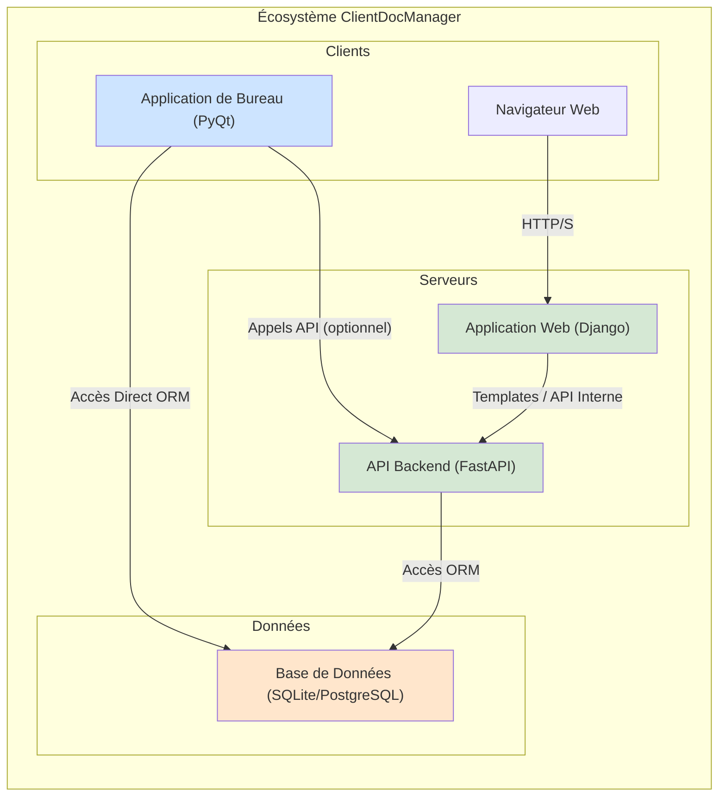

# 2. Architecture Logicielle

Ce document décrit l'architecture globale de l'écosystème ClientDocManager. L'application n'est pas un simple monolithe, mais une suite de composants qui interagissent pour fournir un ensemble complet de fonctionnalités.

## 2.1. Vue d'Ensemble

L'architecture peut être décomposée en quatre composants principaux :

1.  **Application de Bureau (Client Lourd)** : Le cœur du système, fournissant l'interface utilisateur la plus riche pour la gestion quotidienne.
2.  **API Backend** : Un serveur qui expose les données et les fonctionnalités à d'autres clients potentiels (web, mobile) ou pour des intégrations externes.
3.  **Interface Web** : Un portail web, probablement pour l'accès client ou pour des fonctionnalités de tableau de bord plus légères.
4.  **Base de Données** : La couche de persistance centrale, partagée par l'application de bureau et l'API backend.

## 2.2. Diagramme des Composants

Le diagramme suivant illustre les principaux composants et leurs relations.

## 2.3. Description des Composants

### 2.3.1. Application de Bureau

*   **Technologie** : Python 3.x, avec la bibliothèque Qt (via `PyQt` ou `PySide`) pour l'interface utilisateur.
*   **Rôle** : C'est l'outil principal pour les utilisateurs internes (Commerciaux, Chefs de Projet, etc.). Il offre l'ensemble le plus complet de fonctionnalités pour la gestion des clients, des documents, des projets et de la facturation.
*   **Accès aux données** : L'application interagit **directement** avec la base de données via l'ORM SQLAlchemy. Cette approche est typique des clients lourds où la base de données est locale ou sur un réseau local partagé. Pour certaines fonctionnalités, elle pourrait également interagir avec l'API Backend.
*   **Structure du code** :
    *   `gui/` : Contient les fenêtres, dialogues et widgets de l'interface utilisateur.
    *   `db/` : Contient la définition des modèles (`models/`) et la logique d'accès aux données (`cruds/`).
    *   Modules métier (`client_management/`, `project_management/`, etc.) : Contiennent la logique fonctionnelle spécifique à chaque domaine.

### 2.3.2. API Backend

*   **Technologie** : Python 3.x, avec le framework `FastAPI`.
*   **Rôle** : Fournir une interface programmatique (API RESTful) pour accéder aux données et aux fonctionnalités de l'application. Elle sert de "tête" pour les clients légers comme l'application web ou de futures applications mobiles.
*   **Accès aux données** : Comme l'application de bureau, elle utilise la couche d'accès aux données partagée (modèles et CRUDs SQLAlchemy) pour interagir avec la base de données.
*   **Structure du code** :
    *   `api/` : Contient la définition des endpoints de l'API, les modèles de données Pydantic pour la sérialisation, et la logique de dépendances.

### 2.3.3. Interface Web

*   **Technologie** : Python 3.x, avec le framework `Django`.
*   **Rôle** : Offrir une interface web pour certaines fonctionnalités. Il pourrait s'agir d'un portail client, d'un tableau de bord pour les managers, ou d'un site vitrine.
*   **Accès aux données** : L'application Django interagit probablement avec l'API Backend pour récupérer et manipuler les données, afin de ne pas dupliquer la logique métier. Elle pourrait aussi avoir sa propre base de données pour gérer des données spécifiques au web (comme les sessions utilisateur web).
*   **Structure du code** :
    *   `web/` : Contient le projet Django, avec ses applications, modèles, vues et templates.

### 2.3.4. Base de Données

*   **Technologie** : SQLAlchemy ORM, ce qui la rend compatible avec plusieurs SGBD. La configuration par défaut utilise `SQLite`, idéal pour le développement et les déploiements mono-poste. Elle peut être configurée pour utiliser des SGBD plus robustes comme `PostgreSQL` pour des déploiements multi-utilisateurs.
*   **Rôle** : Assurer la persistance, la cohérence et l'intégrité de toutes les données de l'application.

## 2.4. Flux de Données

*   Les données sont créées et modifiées principalement via l'**Application de Bureau**.
*   L'**API Backend** lit ces données et les expose de manière sécurisée. Elle peut également permettre des modifications, en fonction des permissions.
*   L'**Interface Web** consomme les données de l'API pour les afficher à l'utilisateur final dans un navigateur.

Cette architecture hybride (client lourd + API + web) offre une grande flexibilité, mais nécessite une gestion rigoureuse de la couche de données pour éviter les incohérences entre les différents points d'accès.
