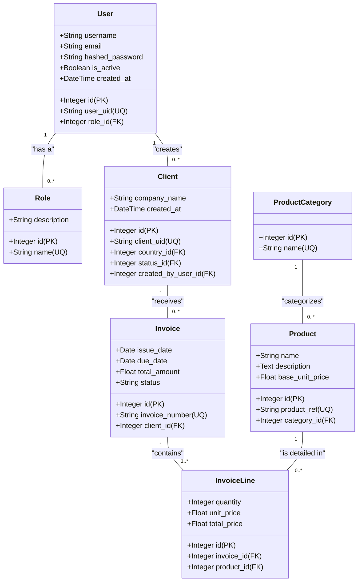

# 3. Conception Statique (Diagramme de Classes)

Ce document présente un diagramme de classes UML pour les principaux domaines métier de l'application ClientDocManager. Ce diagramme n'est pas une représentation de l'état *actuel* de la base de données, mais une version **corrigée et améliorée** qui intègre les recommandations formulées dans le rapport d'analyse et le plan d'amélioration.

## 3.1. Principes de Conception Appliqués

Le diagramme ci-dessous respecte les principes suivants :

*   **Clés Primaires Standardisées** : Toutes les tables utilisent une clé primaire `id` de type `Integer` auto-incrémentée. Les anciens identifiants uniques (comme le `client_id` de type `String`) sont conservés en tant qu'identifiants métier uniques (`uid`) et indexés pour la recherche.
*   **Intégrité Référentielle** : Toutes les relations entre les tables sont établies via des clés étrangères (`_id`) qui pointent vers la clé primaire de la table parente.
*   **Normalisation** : Les entités comme les catégories de produits ont été extraites dans leur propre table pour éviter la redondance et garantir la cohérence.
*   **Relations Complètes** : Les relations, y compris les tables de liaison critiques comme `InvoiceLine`, sont explicitement modélisées.
*   **Clarté des Noms** : Les attributs et les relations sont nommés de manière claire et cohérente.

## 3.2. Diagramme de Classes Corrigé (Domaine Principal)

## 3.3. Description des Entités et Relations

*   **User et Role** :
    *   Un `User` a exactement un `Role`. Un `Role` peut être assigné à plusieurs `User`s.
    *   La table `users` utilise `id` comme PK et `role_id` comme FK vers `roles`.

*   **User et Client** :
    *   Un `User` (un commercial) peut créer et être responsable de plusieurs `Client`s.
    *   La table `clients` a une FK `created_by_user_id` qui pointe vers `users.id`.

*   **Client et Invoice** :
    *   Un `Client` peut recevoir plusieurs `Invoice`s. Chaque `Invoice` est associée à un seul `Client`.
    *   La table `invoices` a une FK `client_id` qui pointe vers `clients.id`.

*   **Product et ProductCategory** :
    *   Un `Product` appartient à une seule `ProductCategory`. Une `ProductCategory` peut contenir plusieurs `Product`s.
    *   Ceci corrige le problème du champ `category` en texte libre. La table `products` a une FK `category_id` vers `product_categories.id`.

*   **Invoice, InvoiceLine, et Product** :
    *   C'est la relation la plus critique qui était manquante.
    *   Une `Invoice` est composée d'une ou plusieurs `InvoiceLine`s.
    *   Chaque `InvoiceLine` détaille un `Product` spécifique, avec une quantité et un prix.
    *   La table `invoice_lines` est une table associative qui lie `invoices` et `products` et contient les détails de la transaction pour chaque produit. Elle a des FK `invoice_id` et `product_id`.

Ce diagramme de classes représente une cible de conception robuste et cohérente pour la refonte de la base de données de l'application.
