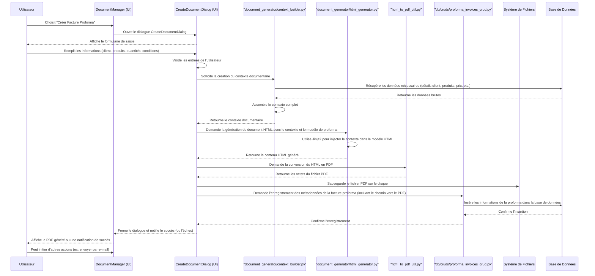

# Module : Gestion des Documents (Desktop)

## 1. Objectif Principal

Le module de Gestion des Documents est au cœur de l'application ClientDocManager. Son objectif principal est de permettre aux utilisateurs de créer, gérer, organiser, et générer une variété de documents commerciaux et administratifs de manière efficace et centralisée. Il vise à standardiser la production documentaire et à faciliter l'accès et le suivi des documents importants.

## 2. Composants Clés et Fonctionnalités

*   **Fenêtre Principale (`DocumentManager` dans `main_window.py`)**:
    *   Sert de point d'entrée principal après la connexion de l'utilisateur.
    *   Fournit la structure de navigation globale (menu, barre d'outils, volets) pour accéder aux différentes fonctionnalités, y compris celles liées aux documents.
    *   Affiche potentiellement des listes de documents récents, des tableaux de bord liés aux documents, ou des vues permettant de parcourir les documents existants.
    *   Contient les actions pour initier la création de nouveaux documents.

*   **Génération de Documents (`document_generator/`)**:
    *   **`html_generator.py`**: Contient la logique pour générer des documents au format HTML à partir de modèles (probablement Jinja2) et de données contextuelles.
    *   **`docx_generator.py`**: Contient la logique pour générer des documents au format DOCX (Microsoft Word) en utilisant la bibliothèque `python-docx`.
    *   **`cover_page_generator.py`**: Spécifiquement pour la génération de pages de garde.
    *   **`context_builder.py`**: Responsable de la collecte et de la structuration des données (contexte) nécessaires pour remplir les modèles de documents. Ce contexte peut inclure des informations sur le client, l'entreprise, les produits, les conditions commerciales, etc.
    *   **Utilisation de Modèles**: Le système s'appuie sur des fichiers de modèles (par exemple, `.docx`, `.html`) qui définissent la structure et les champs variables des documents. Ces modèles sont stockés dans le dossier `templates/` (organisé par langue).

*   **Conversion HTML vers PDF (`html_to_pdf_util.py`)**:
    *   Fournit des utilitaires pour convertir le contenu HTML (généré par `html_generator.py` ou autre) en documents PDF. Cela implique généralement une bibliothèque ou un outil externe (ex: WeasyPrint, ReportLab, ou un appel à une API si la conversion est externalisée).

*   **Dialogues Spécifiques aux Documents**:
    *   **`dialogs/create_document_dialog.py`**: Interface utilisateur permettant de sélectionner le type de document à créer, de choisir un client, d'ajouter des produits, de spécifier des conditions, etc., avant la génération.
    *   **`dialogs/compile_pdf_dialog.py`**: Potentiellement pour assembler plusieurs documents en un seul PDF ou pour des options de compilation avancées.
    *   **`dialogs/select_client_attachment_dialog.py`**, **`dialogs/select_utility_attachment_dialog.py`**: Pour sélectionner et gérer les pièces jointes aux documents ou aux entités liées.
    *   **`project_management/dialogs/cover_page_editor_dialog.py`**: Éditeur spécifique pour les pages de garde dans le contexte de la gestion de projet.

*   **Types de Documents Gérés (Exemples basés sur les modèles et la structure)**:
    *   Factures Proforma (`proforma_invoice_template.html`, `proforma_template.xlsx`)
    *   Factures Finales (logique dans `invoicing/`)
    *   Contrats de Vente (`sales_contract_template.html`, `contrat_vente_template.xlsx`)
    *   Spécifications Techniques (`technical_specifications_template.html`, `specification_technique_template.xlsx`)
    *   Packing Lists (`packing_list_template.html`, `packing_liste_template.xlsx`)
    *   Images Produits (document listant des images produits - `product_images_template.html`)
    *   Documents de Garantie (`warranty_document_template.html`)
    *   Pages de Contact (`contact_page_template.html`)
    *   Pages de Garde

*   **Stockage et Organisation**:
    *   Les documents générés sont susceptibles d'être stockés dans des emplacements spécifiques (par exemple, liés aux clients, aux projets).
    *   La base de données (`db/models/documents.py`, `db/models/project_files.py`, etc.) contient les métadonnées des documents (nom, type, date, chemin d'accès, liens vers d'autres entités).

*   **Fonctionnalités Associées**:
    *   Recherche et filtrage de documents.
    *   Prévisualisation des documents.
    *   Envoi de documents par e-mail (via `email_service.py`).
    *   Gestion des versions (moins probable dans la structure actuelle, mais une considération).
    *   Archivage de documents.

## 3. Flux de Travail Typique (Exemple : Création d'une Facture Proforma)

Le diagramme de séquence ci-dessous illustre les principales interactions lors de la création d'une facture proforma :

**Description des étapes du flux :**

1.  **Initiation**: L'utilisateur, depuis `DocumentManager` (la fenêtre principale), choisit l'action de créer une nouvelle facture proforma.
2.  **Ouverture du Dialogue**: Le `DocumentManager` instancie et affiche le `CreateDocumentDialog` (ou un dialogue spécialisé équivalent).
3.  **Sélection et Saisie des Données**:
    *   Dans le `CreateDocumentDialog`, l'utilisateur sélectionne un client existant (probablement via un sélecteur qui interroge `db/cruds/clients_crud.py`).
    *   L'utilisateur ajoute des produits ou services. Pour chaque ligne, il spécifie le produit (sélectionné depuis une liste issue de `db/cruds/products_crud.py`), la quantité, et le prix (qui peut être pré-rempli à partir des données du produit mais modifiable).
    *   L'utilisateur peut également ajuster d'autres paramètres comme les conditions de paiement, les dates, ou ajouter des notes.
4.  **Validation et Collecte du Contexte Documentaire**:
    *   Une fois les saisies terminées, l'utilisateur valide le dialogue.
    *   Le `CreateDocumentDialog` effectue une première validation des données.
    *   Il fait appel au `document_generator/context_builder.py`. Ce dernier récupère toutes les informations détaillées nécessaires (données complètes du client, de l'entreprise de l'utilisateur, détails des produits, calculs de totaux, taxes, etc.) en interagissant avec les différents modules CRUD et la base de données. Le `context_builder` retourne un dictionnaire de contexte structuré.
5.  **Génération du Document (HTML)**:
    *   Le `CreateDocumentDialog` (ou une classe de service qu'il appelle) transmet le contexte et le chemin du modèle de facture proforma (ex: `templates/fr/proforma_invoice_template.html`) au `document_generator/html_generator.py`.
    *   Le `html_generator.py` utilise un moteur de template (comme Jinja2) pour fusionner le contexte avec le modèle HTML, produisant ainsi le contenu HTML final de la facture proforma.
6.  **Conversion en PDF (si applicable)**:
    *   Le contenu HTML généré est ensuite passé au `html_to_pdf_util.py`.
    *   Cet utilitaire convertit le HTML en un document PDF (sous forme d'octets).
7.  **Sauvegarde et Enregistrement en Base de Données**:
    *   Le fichier PDF (les octets) est sauvegardé sur le système de fichiers, dans un emplacement approprié (par exemple, un dossier spécifique au client ou un dossier général de documents). Le chemin du fichier est conservé.
    *   Les métadonnées de la facture proforma (numéro, date, client_id, montant total, chemin vers le fichier PDF, etc.) sont enregistrées dans la base de données via `db/cruds/proforma_invoices_crud.py`.
    *   Le `CreateDocumentDialog` se ferme et peut notifier le `DocumentManager` du succès de l'opération.
8.  **Affichage et Actions Postérieures**:
    *   Le `DocumentManager` peut alors afficher une notification de succès à l'utilisateur.
    *   Le document PDF généré peut être automatiquement ouvert pour prévisualisation.
    *   L'utilisateur peut ensuite choisir d'effectuer d'autres actions, comme envoyer la facture proforma par e-mail (ce qui impliquerait le [Module Gestion des E-mails (Interface Utilisateur)](./module_gestion_emails_ui.md)).

## 4. Interactions avec d'Autres Modules

*   **Authentification et Gestion des Utilisateurs**: Détermine qui peut créer/modifier/visualiser certains types de documents en fonction des rôles et permissions. Les informations de l'utilisateur peuvent apparaître sur les documents (ex: "créé par").
*   **Gestion des Clients**: Fournit les informations client (nom, adresse, contact) pour les documents. Les documents sont souvent liés à des clients spécifiques.
*   **Gestion des Produits**: Fournit les descriptions, prix, et autres détails des produits/services listés dans les documents.
*   **Facturation et Paiements**: La génération de factures finales est une extension de ce module. Les proformas peuvent être converties en factures.
*   **Gestion de Projet**: Les documents peuvent être liés à des projets spécifiques (plans, rapports, contrats).
*   **Paramètres et Configuration**: Les modèles de documents, les informations de l'entreprise de l'utilisateur (logo, adresse pour les en-têtes) sont configurés ici.
*   **Gestion des E-mails**: Utilisé pour envoyer les documents générés aux clients ou autres destinataires.
*   **Base de Données**: Tous les métadonnées des documents et les liens vers les fichiers sont stockés et gérés via la couche d'accès aux données.

## 5. Points d'Attention

*   **Gestion des Modèles**: La flexibilité et la facilité de modification des modèles de documents sont cruciales.
*   **Performance de Génération**: Pour les documents complexes ou volumineux, la performance du processus de génération et de conversion PDF est importante.
*   **Cohérence des Données**: Assurer que les données utilisées pour générer les documents (prix des produits, adresses clients) sont à jour et exactes.
*   **Sécurité d'Accès**: Contrôler qui peut accéder à quels documents.
