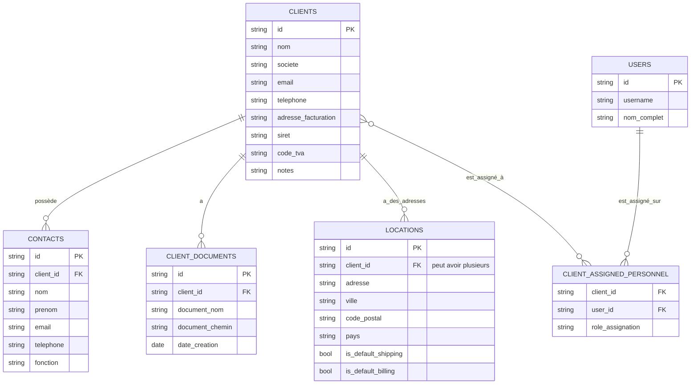
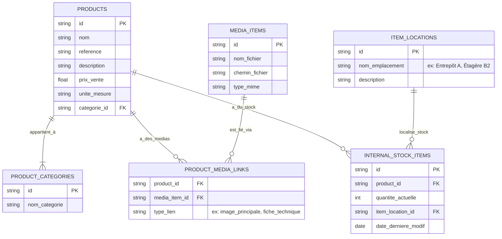
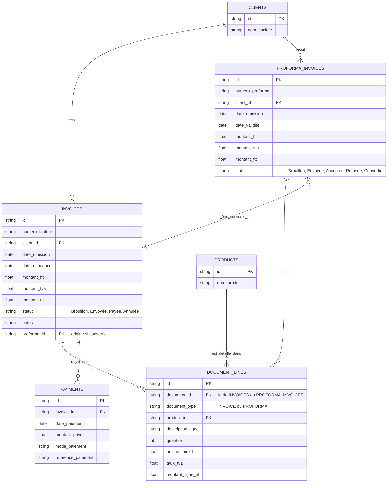
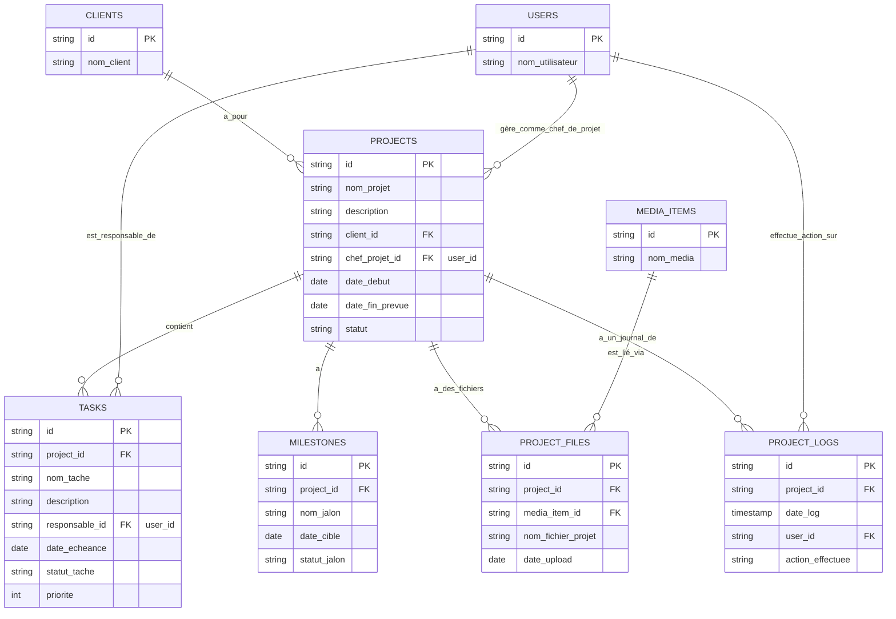
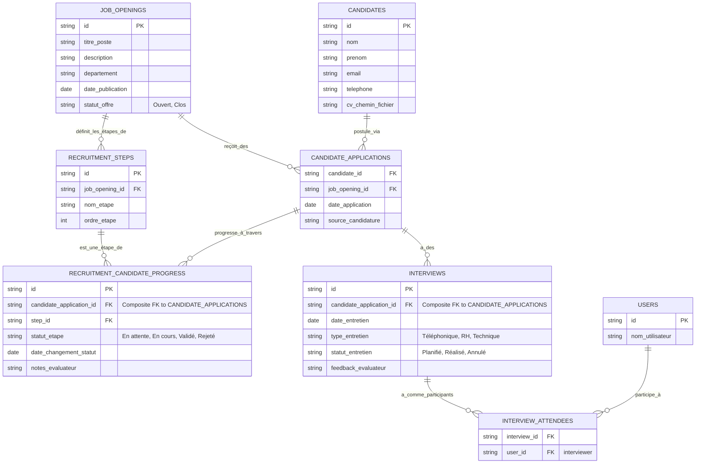

# Module : Structure de la Base de Données (Desktop)

## 1. Objectif Principal

La base de données est le cœur de la persistance des données pour l'application ClientDocManager. Ce document décrit son schéma général, les principales tables (modèles SQLAlchemy), leurs relations, et la manière dont l'application interagit avec elle via la couche d'accès aux données (DAL). L'objectif est de fournir une compréhension de la manière dont les informations sont stockées et organisées.

## 2. Technologie et Configuration

*   **ORM (Object-Relational Mapper)**: SQLAlchemy est utilisé comme ORM, ce qui permet de définir la structure de la base de données en utilisant des classes Python (modèles) et d'interagir avec la base de données de manière orientée objet.
*   **Moteur de Base de Données**: Bien que SQLAlchemy supporte de nombreux SGBD, la configuration par défaut semble pointer vers SQLite (typique pour les applications desktop Python pour sa simplicité de déploiement). Le fichier `db/connection.py` gère la création du moteur et des sessions SQLAlchemy.
    *   `DATABASE_URL = "sqlite:///./client_manager_app.db"`
*   **Initialisation du Schéma**: `db/init_schema.py` contient la logique (`initialize_database`) pour créer toutes les tables définies dans les modèles si elles n'existent pas déjà. Cette fonction est appelée au démarrage de l'application (`main.py`).
*   **Seeding de Données Initiales**: `db/db_seed.py` (`run_seed`) est utilisé pour peupler la base de données avec des données initiales ou de démonstration après la création du schéma (par exemple, rôles par défaut, paramètres initiaux, modèles de documents de base).

## 3. Modèles de Données Principaux (Tables)

Les modèles de données sont définis dans le dossier `db/models/`. Chaque fichier `.py` dans ce dossier correspond généralement à une ou plusieurs tables de la base de données. Voici une liste non exhaustive des entités principales et de leurs tables associées (basée sur les noms de fichiers et les dépendances observées) :

*   **Utilisateurs et Accès**:
    *   `users.py`: Table `users` (stocke les informations des utilisateurs de l'application : id, nom d'utilisateur, mot de passe haché, e-mail, rôle, etc.).
    *   `roles.py` (potentiel, ou rôles gérés statiquement) : Table `roles` (si les rôles sont dynamiques).
    *   `permissions.py` (potentiel) : Table `permissions` et tables de liaison pour les permissions des rôles.
    *   `sessions.py` (potentiel) : Pourrait stocker des informations de session persistantes.

*   **Clients et Contacts**:
    *   `clients.py`: Table `clients` (informations sur les entreprises clientes).
    *   `contacts.py`: Table `contacts` (personnes contact, liées aux clients ou indépendantes).
    *   `client_assigned_personnel.py`: Table de liaison pour assigner des employés (utilisateurs) à des clients.
    *   `client_documents.py`: Table de liaison pour les documents spécifiques aux clients.
    *   `client_freight_forwarders.py`, `client_money_transfer_agents.py`, `client_transporters.py`: Tables de liaison pour associer des partenaires logistiques/financiers aux clients.

*   **Produits et Stock**:
    *   `products.py`: Table `products` (catalogue des produits et services).
    *   `product_media_link.py`: Table de liaison pour les médias (images, fiches techniques) associés aux produits.
    *   `internal_stock_item.py`: Table `internal_stock_items` (gestion des items en stock).
    *   `item_location.py`: Table `item_locations` (localisation des items en stock).

*   **Documents et Modèles**:
    *   `documents.py` (générique) ou des tables spécifiques par type :
        *   `proforma_invoices.py`: Table `proforma_invoices`.
        *   `invoices.py`: Table `invoices` (factures finales).
        *   `sales_contracts.py` (nom supposé) : Table pour les contrats de vente.
    *   `document_lines.py` (nom supposé) : Table pour les lignes d'items dans les documents (produits, quantités, prix).
    *   `templates.py`: Table `templates` (références aux fichiers modèles de documents).
    *   `cover_pages.py`, `cover_page_templates.py`: Pour les pages de garde.

*   **Projets**:
    *   `projects.py`: Table `projects`.
    *   `tasks.py` (nom supposé) : Table `tasks` (tâches des projets).
    *   `milestones.py`: Table `milestones` (jalons des projets).
    *   `project_files.py`: Table de liaison pour les fichiers attachés aux projets.
    *   `project_logs.py`: Table pour journaliser les activités d'un projet.
    *   `production_orders.py`, `production_steps.py`: Si la gestion de production est activée pour les projets.

*   **Recrutement**:
    *   `recruitment_job_openings.py`: Table `job_openings`.
    *   `recruitment_candidates.py`: Table `candidates`.
    *   `recruitment_interviews.py`: Table `interviews`.
    *   `recruitment_steps.py`: Table `recruitment_steps` (étapes du processus).
    *   `recruitment_candidate_progress.py`: Suivi de l'avancement des candidats.

*   **RH et Employés**:
    *   `employees.py`: Table `employees` (informations sur les employés de l'entreprise).
    *   `employee_documents.py`: Documents liés aux employés (contrats, etc.).
    *   `experience.py`: Expérience professionnelle des employés.
    *   `leave.py`: Gestion des congés.
    *   `performance.py`: Suivi de la performance.
    *   `hr_reports.py`: Rapports RH.

*   **Finances et Comptabilité (Entreprise)**:
    *   `payments.py`: Table `payments` (paiements reçus des clients).
    *   `company_expenses.py`: Table `company_expenses` (dépenses de l'entreprise).
    *   `company_assets.py`: Table `company_assets` (actifs de l'entreprise).
    *   `asset_assignments.py`: Assignations des actifs.
    *   `asset_media_links.py`: Médias liés aux actifs.

*   **Paramètres et Divers**:
    *   `application_settings.py`: Table `application_settings` (stockage clé-valeur de paramètres).
    *   `companies.py`: Table `companies` (informations sur l'entreprise utilisatrice de l'application, et potentiellement d'autres si multi-société).
    *   `locations.py`: Table `locations` (adresses, sites).
    *   `media_items.py`: Table `media_items` (référentiel central pour les fichiers médias).
    *   `google_sync.py`: Table `google_sync_status` (pour la synchronisation des contacts Google).
    *   `partners.py`: Table `partners` (partenaires commerciaux).
    *   `activity_logs.py`: Journal d'activité global de l'application.

## 4. Relations Clés (Exemples)

*   **One-to-Many**:
    *   Un `Client` peut avoir plusieurs `Contacts`.
    *   Un `Client` peut avoir plusieurs `Invoices`.
    *   Un `Project` peut avoir plusieurs `Tasks` et plusieurs `ProjectFiles`.
    *   Une `JobOpening` peut avoir plusieurs `Candidates` (via une table de liaison ou une référence directe).
*   **Many-to-Many**:
    *   Produits et Documents : Un produit peut être dans plusieurs documents, et un document peut contenir plusieurs produits (via une table de liaison `DocumentLines`).
    *   Utilisateurs et Projets (membres de l'équipe) : Un utilisateur peut être membre de plusieurs projets, un projet peut avoir plusieurs membres (via une table de liaison).
*   **Foreign Keys**: Les relations sont établies à l'aide de clés étrangères (par exemple, `invoice.client_id` référence `clients.id`).
*   **Cascading**: Des règles de suppression ou de mise à jour en cascade peuvent être définies au niveau de l'ORM ou de la base de données pour maintenir l'intégrité référentielle.

### 4.1. Diagramme ER Simplifié : Clients et Entités Liées

*(Note: Ce diagramme est une simplification. Les noms exacts des champs et toutes les relations peuvent varier. `LOCATIONS` est inclus ici comme exemple d'adresses multiples pour un client.)*

### 4.2. Diagramme ER Simplifié : Produits et Stock

*(Note: Ce diagramme est une simplification. La gestion des prix d'achat, fournisseurs par défaut, ou variantes de produits ne sont pas explicitement montrés ici mais pourraient exister.)*

### 4.3. Diagramme ER Simplifié : Documents Commerciaux (Factures/Proformas)

*(Note: Simplification. Les aspects comme les adresses de facturation/livraison spécifiques au document, les taxes multiples, ou les conditions de paiement détaillées ne sont pas tous montrés.)*

### 4.4. Diagramme ER Simplifié : Gestion de Projet

*(Note: Ce diagramme est une simplification. Les dépendances entre tâches, l'assignation de multiples membres d'équipe à un projet/tâche, ou le suivi budgétaire ne sont pas montrés.)*

### 4.5. Diagramme ER Simplifié : Recrutement

*(Note: Ce diagramme est une simplification. La liaison des documents CV/LM directement à `CANDIDATES` est une simplification ; une table `CANDIDATE_DOCUMENTS` serait plus flexible. `CANDIDATE_APPLICATIONS` est introduite pour gérer le fait qu'un candidat peut postuler à plusieurs offres.)*

## 5. Couche d'Accès aux Données (CRUDs)

*   Le dossier `db/cruds/` contient des modules Python chacun étant dédié aux opérations CRUD (Create, Read, Update, Delete) pour une ou plusieurs tables/modèles.
    *   Exemple: `db/cruds/clients_crud.py` contient des fonctions comme `add_client`, `get_client_by_id`, `update_client`, `delete_client`, `get_all_clients`.
*   Ces fonctions CRUD utilisent la session SQLAlchemy (obtenue via `db.connection.SessionLocal()`) pour interagir avec la base de données.
*   Elles fournissent une abstraction à la logique métier, qui n'a pas besoin de connaître les détails des requêtes SQL ou des appels ORM spécifiques.
*   **`generic_crud.py`**: Peut contenir une classe de base ou des fonctions utilitaires pour des opérations CRUD communes, réduisant la répétition de code dans les CRUDs spécifiques.

## 6. Points d'Attention

*   **Intégrité Référentielle**: Cruciale pour la cohérence des données. Les clés étrangères et les contraintes doivent être correctement définies.
*   **Performance des Requêtes**: Avec l'augmentation du volume de données, certaines requêtes peuvent devenir lentes. L'indexation des colonnes fréquemment utilisées dans les clauses `WHERE`, `JOIN`, et `ORDER BY` est essentielle.
*   **Migrations de Schéma**: Lorsque la structure des modèles de données évolue (ajout de colonnes, modification de tables), un mécanisme de migration de schéma (comme Alembic, qui est souvent utilisé avec SQLAlchemy) est nécessaire pour mettre à jour la base de données existante sans perte de données. (La présence d'Alembic n'est pas confirmée ici, mais c'est une bonne pratique).
*   **Transactions**: Les opérations qui modifient plusieurs tables ou qui doivent être atomiques (tout ou rien) doivent être enveloppées dans des transactions pour garantir la cohérence des données en cas d'erreur.
*   **Sécurité**: L'accès direct à la base de données doit être limité. L'application doit interagir avec la base de données uniquement via la DAL (CRUDs) pour appliquer la logique métier et les contrôles de permission.
*   **Sauvegarde et Restauration**: Des stratégies de sauvegarde régulières de la base de données sont indispensables pour prévenir la perte de données.

Ce document fournit une vue d'ensemble. Pour des détails précis sur chaque table, ses colonnes, et ses relations, il faudrait consulter directement les fichiers modèles dans `db/models/`.
